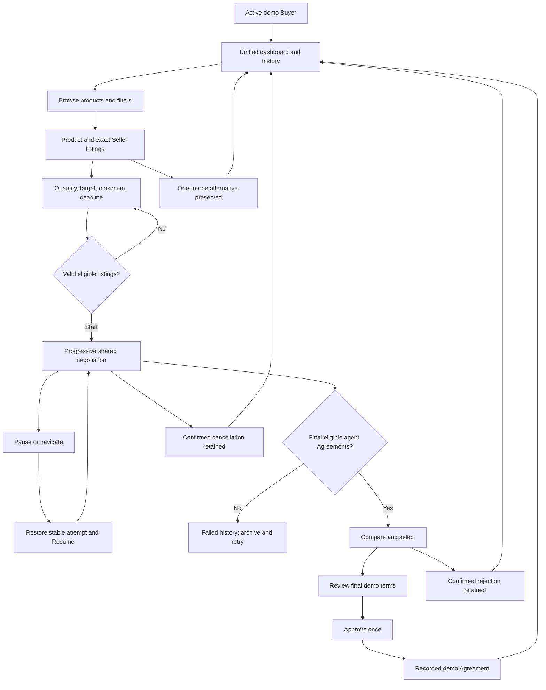
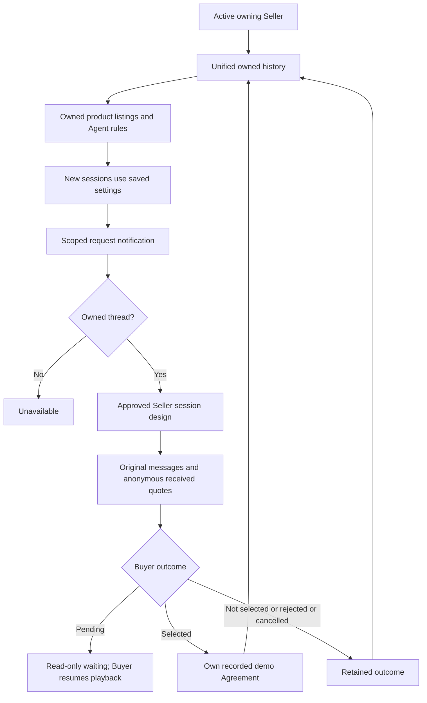
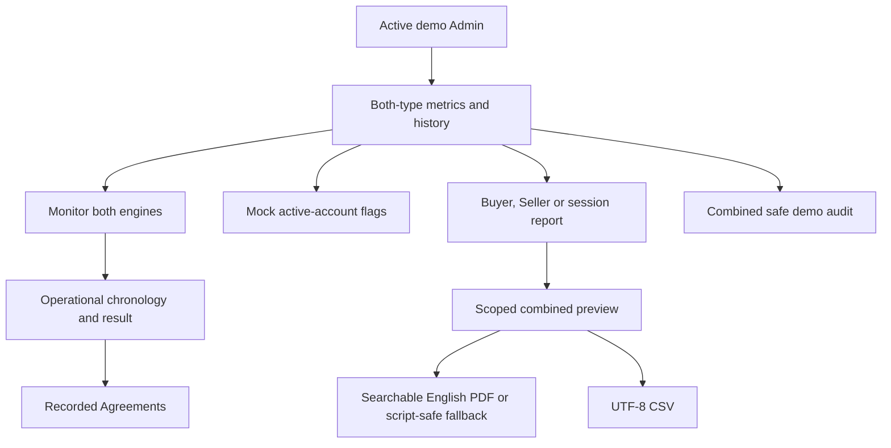
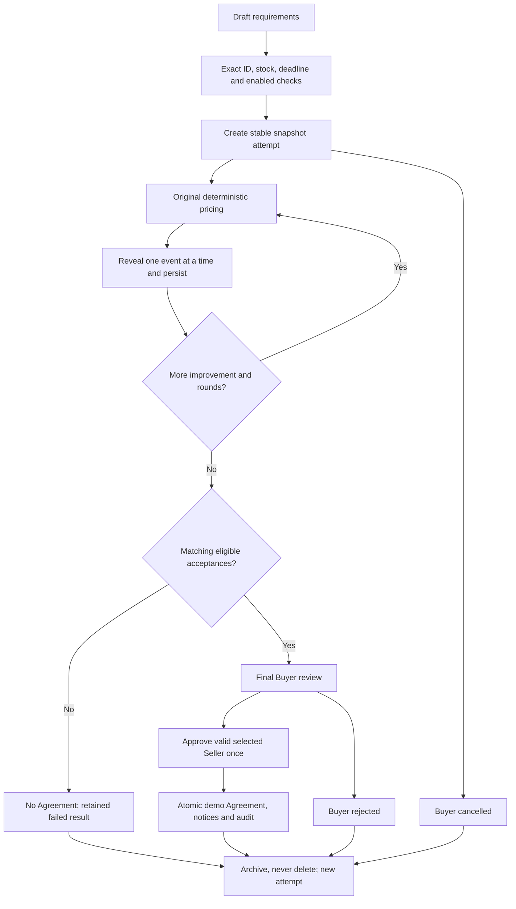
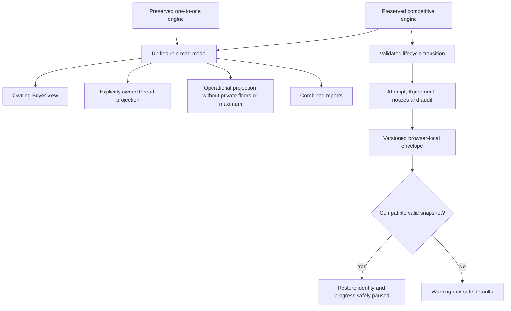

# AutoNegotiater — Complete User Journeys (Current Local Implementation)

Updated **19 October 2026 (Asia/Riyadh)** after the Seller-owned product and shared-navigation implementation. This replaces the pre-integration audit as the description of current behavior. The original audit is recoverable from `checkpoints/before-integration-20261018-060432.zip`. Original finding IDs and their resolution evidence are retained in `AUTONEGOTIATER_IMPLEMENTATION_REPORT.md`.

## 1. Executive Summary

The isolated demo now connects Buyer, Seller and Admin journeys through a **unified, typed read model**. One-to-one and competitive pricing engines remain separate. Competitive attempts have stable IDs, retained histories, explicit decisions, recorded demo Agreements, scoped notifications/audit, and Admin reporting. Browser-local state survives refresh with schema validation.

The approved Buyer and Seller negotiation content remains in place. All roles now use the Buyer Workspace shared header/sidebar, including competitive session details, with role-specific destinations, consistent existing SVG icons, nested active states and a collapsible mobile menu. Seller-owned listing configuration controls new competitive sessions; existing snapshots do not change. No real orders, payments, shipments, stock reservations, Gemini calls, production authentication or server synchronization are implemented.

Status legend: **IMPLEMENTED** = working code for the stated interface, **MOCK ONLY** = browser-local synthetic functionality, **PARTIAL** = relevant limits remain, **MISSING** = absent, **UNVERIFIED** = not established by current verification. These labels never certify production readiness.

## 2. Structure, State and Routes

Next.js 15.5.4, React 19.1.1, TypeScript 5.9.2, Tailwind 4.1.13 and existing scoped CSS are retained. No dependency was installed or upgraded. `frontend/lib/api.ts` and FastAPI contracts are unchanged. Mock mode requires development plus `USE_MOCK_DATA=true`; `next start` is intentionally not the offline demo command.

| Layer | Current source and responsibility |
|---|---|
| Legacy engine | `frontend/lib/demo-model.ts`, `components/demo-provider.tsx`: one-to-one turns, legacy Deals, stock decrement, notices and audit |
| Competitive engine | `frontend/lib/competitive.ts`: exact catalog identity, owned inventory, progressive offers and pricing bounds |
| Integration | `frontend/lib/demo-integration.ts`: pure transitions, retained Attempt, DemoAgreement, events/audit, typed SessionRead and validation |
| Competitive context | `frontend/components/competitive-provider.tsx`: role-safe projections, owned settings, public listing previews and actions |
| Persistence | `frontend/lib/demo-storage.ts`, `components/local-demo-state.tsx`: versioned browser storage, validation, recovery/loading/warnings |
| Unified screens | `frontend/components/unified-workspace.tsx`: role overview/history/Agreement details/notifications/Admin monitoring |
| Seller configuration | `frontend/components/storefront-manager.tsx`: explicitly owned listing settings |
| Approved interfaces | `components/competitive-negotiation.tsx`, `seller-session-view.tsx`, `seller-competitive.tsx`, `site-shell.tsx`; existing visual primitives/CSS |
| Reports | `lib/integrated-reports.ts`, existing `reports.ts`, `report-download.ts`, new `text-report-pdf.ts`, `components/admin-reports.tsx` |

### Route map

Role subpages are logical handlers inside the existing catch-all routes. Unknown sections retain explanatory empty states.

| Route | Purpose |
|---|---|
| `/`, `/products`, `/products/[id]` | Landing, loaded-catalog search/filter/sort/comparison and selected-product requirements |
| `/login`, `/register`, `/profile` | Synthetic identity selection/creation, editable profile, demo sign-out, deliberate browser reset |
| `/notifications` | Combined scoped events from both engines, read/unread and linked records |
| `/products/[id]/negotiate` | Preserved one-to-one alternative |
| `/products/[id]/competitive` | Latest unarchived competitive attempt for owning Buyer/product |
| `/dashboard/{role}` | Combined role metrics and session history |
| `/dashboard/{role}/negotiations` | Search/filter both negotiation types; resume/detail links |
| `/dashboard/{role}/negotiations/[numericId]` | Existing owned/authorized legacy session detail |
| `/dashboard/buyer/competitive/[attemptId]` | Stable Buyer attempt detail using approved interface, including older attempts |
| `/dashboard/admin/competitive/[attemptId]` | Operational competitive monitoring without private limits |
| `/dashboard/seller/competitive-session/[attemptId]` | Owned product-listing conversation selector and approved Seller session content |
| `/dashboard/seller/competitive/[threadId]` | Exact owned thread detail; foreign IDs denied |
| `/dashboard/{role}/deals` | Unified recorded demo Agreements from both engines |
| `/dashboard/{role}/deals/[numericId]` | Preserved legacy Agreement detail/print and Buyer feedback |
| `/dashboard/{role}/agreements/[agreementId]` | Recorded competitive Agreement, ownership guard, source-session link/print |
| `/dashboard/seller/products` | My Products & Agent Settings: all owned listings, add/edit/configure Agent |
| `/dashboard/seller/storefronts` | Legacy compatibility alias to the same product manager; not a separate navigation item |
| `/dashboard/seller/products`, `/new`, `/[id]/edit`, `/[id]/rules` | Owned primary catalog and legacy/primary competitive rules |
| `/dashboard/seller/negotiations?view=requests`, `active`, `completed` | Unified history query filters apply to both types |
| `/dashboard/{role}/notifications` | Same scoped combined notification interface |
| `/dashboard/admin/users`, `/sellers`, `/products` | Mock governance and public product monitoring |
| `/dashboard/admin/reports` | Buyer/Seller/session reports covering both engines |
| `/dashboard/admin/permissions` | Honest static matrix and production-policy requirements; no fake editor |
| `/dashboard/admin/system`, `/audit-logs` | Combined local metrics and events; not live service monitoring/immutable audit |

Initial identities remain Ahmed (Seller 1), Sara (Seller 2), Khalid (Seller 3), Noura (Buyer 4), Faisal (Buyer 5), Admin (6). Registration adds synthetic Buyer/Seller identities. Suspended accounts are disabled in selectors/login/role cards, denied action transitions, and cannot use role workspaces. Sign-out clears selected identity to Guest 0; saved records are retained deliberately. Guest profile editing is denied.

## 3. Buyer Journey

All state-changing behavior here is **MOCK ONLY** unless specifically stated.

| Step | Page | Goal | Action | System response | Next | Status | Source |
|---|---|---|---|---|---|---|---|
| B01 | Landing | Understand demo | Read process; Explore | Explains discovery, limits, agents, approval | Marketplace/login | IMPLEMENTED | app/page.tsx |
| B02 | Register/login | Enter as Buyer | Register synthetic identity or select active Buyer | Browser-local account/selection, no password/token | Buyer overview | MOCK ONLY | demo-pages AccountScreen, demo-provider |
| B03 | Buyer overview | Resume any negotiation | Review combined metrics/history | Both types, accurate statuses and stable links | Existing session/catalog | MOCK ONLY | unified-workspace |
| B04 | Marketplace | Find product | Search, category/stock filter, sort/reset | Filters loaded array locally | Details | IMPLEMENTED UI | products.tsx |
| B05 | Marketplace | Compare listings | Select up to three | Public cross-product comparison, distinct from same-item competition | Select product | IMPLEMENTED UI | products.tsx |
| B06 | Details | Inspect product/Sellers | View gallery, public reference, Seller cards | Exact catalog matching, current public listing settings, exclusions | Requirements | MOCK ONLY | competitive-negotiation, competitive-provider |
| B07 | Details/Edit | Configure request | Quantity, target/unit, private maximum/unit, deadline, rounds | Validates range, cent precision, target <= maximum | Ready state | MOCK ONLY | competitive validateRequirements |
| B08 | Details | Start competition | Start Multi-Seller Negotiation | New stable Attempt and scoped request events; one live attempt per Buyer/product | Live interface | MOCK ONLY | demo-integration transition |
| B09 | Live/detail | Follow negotiation | Auto, Pause/Resume, Next message | Original independent threads advance progressively with bounded offers | Later rounds | MOCK ONLY | competitive engine, Buyer component |
| B10 | Live/detail | Inspect each Seller | Card/selector/full-conversation modal | Own parent session's threads, sequence, rounds and received anonymous announcements | Compare | MOCK ONLY | competitive-negotiation |
| B11 | Navigation/refresh | Retain progress | Leave, revisit history or reload | Same attempt/history restored; resumed view starts safely paused | Explicit Resume | MOCK ONLY | persistence, playback effects |
| B12 | Review | Compare Agreements | Read final eligible prices/delivery; select radio | Only accepted eligible quotes can be selected after completion | Review final terms | MOCK ONLY | rankedOffers, Buyer component |
| B13 | Review modal | Approve | Approve Selected Offer, then Confirm Demo Agreement | Revalidates own session/state/matching acceptance; atomically records one demo Agreement and events | Agreement/history | MOCK ONLY | transition approve |
| B14 | Review | Decline | Reject all offers, confirm rejection | Terminal rejected state, retained history, scoped notifications | History/retry | MOCK ONLY | transition reject |
| B15 | Running/review | Cancel | Cancel negotiation, confirm | Terminal cancelled state; partial history retained; no Agreement | History/retry | MOCK ONLY | transition cancel |
| B16 | Failed/terminal | Retry | Restart confirmation | Archives eligible terminal attempt; no deletion; active/review attempt must be finalized first | New configuration | MOCK ONLY | archive/restart |
| B17 | History | Revisit prior outcome | Open stable attempt link | Original snapshot/messages/result, regardless of current product's latest attempt | Agreement/source | MOCK ONLY | unified-workspace |
| B18 | Agreements/detail | Inspect recorded terms | Open record/Print/source link | ID, parties, product listing/catalog, quantity, unit/total, delivery and approval timestamp | History | MOCK ONLY | UnifiedAgreementDetail |
| B19 | Product/negotiate | Use alternative | Budget, mode, scripted conditions/scenario | Existing one-to-one flow preserved | Legacy session detail | MOCK ONLY | negotiation.tsx |
| B20 | Legacy detail | Execute/decide | Next turn; Confirm/Reject/Cancel | Original pricing, failure paths and authorized automated completion | Legacy Agreement | MOCK ONLY | demo-model |
| B21 | Legacy Agreement | Review/feedback | Print, rate/feedback | Existing local rating remains; no competitive review form yet | History | MOCK ONLY / PARTIAL | demo-pages DealDetail |
| B22 | Notifications/profile | Account/activity | Open/read events, edit profile, sign out/reset | Scoped persistent events and profile; reset is deliberate/destructive | Linked record/login | MOCK ONLY | unified-workspace, AccountScreen |

Draft input before Start and legacy private component notes are not durable negotiated records. No real order, cart, payment, shipping, inventory reservation or shipment tracking is introduced.

## 4. Seller Journey

Business model: **Seller → Product Listings → Negotiation Sessions → Agreements**. Each listing has an explicit owner Seller ID, stable unique listing ID and exact catalog/variant ID. A Seller may own multiple independent listings for the same catalog product; they are never automatically merged. Existing synthetic owner assignments and all listing/session IDs remain unchanged. Display names come from Seller accounts, with listing IDs to distinguish multiple offers. Legacy store keys/names are compatibility fields in storage only. No separate store entity is managed.

| Step | Page | Goal | Action | System response | Next | Status | Source |
|---|---|---|---|---|---|---|---|
| S01 | Identity selector | Enter Seller | Select active Seller | Correct role workspace; no production authentication | Overview | MOCK ONLY | site-shell/demo-provider |
| S02 | Overview/history | Review activity | Combined metrics/filter/search | Own relevant legacy and competitive records, including own selected/not-selected/excluded outcomes | Detail/settings | MOCK ONLY | unified read model |
| S03 | My Products & Agent Settings | Manage owned listings | Search product/listing cards | Only the selected Seller's listings, images, prices, stock, delivery and Agent status | Add / Edit Product / Configure Agent | MOCK ONLY | SellerProductsManager/provider |
| S04 | Product listing form | Configure Agent | Opening, private minimum, discount, stock, delivery, rounds, concession, strategy/enabled; no store-name field | Validates owner/identity/bounds; saves future settings and safe audit event | New-session behavior | MOCK ONLY | transition settings |
| S05 | Settings save | Understand snapshots | Read settings notice | New sessions use saved settings; existing snapshots unchanged | Session monitoring | MOCK ONLY | configuredListings |
| S06 | Primary product/rules | Maintain catalog | Add/edit allowed public fields or legacy rules | Existing names/categories locked as variant identity; new product for new variant; primary price/stock/rules synchronized where edited | Catalog | MOCK ONLY | ProductForm/RulesForm |
| S07 | Requests/notices | Receive request | Open own notification | Actual event, unread flag and stable own session link | Own session | MOCK ONLY | scoped integration notices |
| S08 | Session list | Locate records | Search/type/status/query filters | Both types filtered consistently within role scope | Open | MOCK ONLY | UnifiedWorkspace |
| S09 | Competitive parent | Choose own thread | Select your Negotiation Session / product listing | Only owned listing conversations offered | Approved Seller view | MOCK ONLY | SellerSessionPicker |
| S10 | Competitive detail | Inspect terms | Read product/Buyer requirements/private own settings | Snapshot product/stock/settings; Buyer maximum excluded | Conversation | MOCK ONLY | seller-session-view |
| S11 | Conversation | Monitor agent | Read original Buyer/Seller messages | Same shared history, prices and rounds; no independent Seller engine | Result | MOCK ONLY | sellerCompetitiveViews |
| S12 | Competition panel | Understand pressure | Read received quotes/history | Only anonymous messages actually announced to own agent | Own later offer | MOCK ONLY | competitive engine/projection |
| S13 | Offer panel | Review own quote | View Offer Details | Correct quantity/unit/total/delivery; not a transaction | Result | MOCK ONLY | seller-session-view |
| S14 | Result | Track decision | Read phase/agent/Buyer outcome | Distinguishes provisional, pending, selected, not selected, rejected, cancelled, excluded/no Agreement | Agreements/history | MOCK ONLY | projections/result text |
| S15 | Agreements | Inspect success | Open recorded demo Agreement | Only owning selected Seller receives its Agreement; no contradictory legacy empty state | Source session | MOCK ONLY | unified-workspace |
| S16 | Refresh/switch | Continue view | Reload or choose identity | Saved state restored; scope recomputed; foreign direct links denied | Owned detail | MOCK ONLY | validation/projections |
| S17 | Notifications/profile | Manage account/activity | Mark read, edit profile, sign out | Correct own unread counts and persistent history | Linked record/login | MOCK ONLY | unified notifications/profile |
| S18 | Fulfillment | Dispatch real goods | Look for orders/shipment | Not implemented; Agreement explicitly says demo only | Outside local scope | MISSING | honest Agreement UI |

Sellers can add a separate listing for an existing exact catalog variant, create a new catalog product/variant through the existing form, edit owned listing details and configure each Agent independently. Adding never merges another listing. Store display-name editing and separate store management are removed. Effective floor = max(declared private minimum, opening price after maximum allowed discount), rounded up to a cent. Competitive rounds remain 1–12; legacy supports up to 20. Saved listing settings affect future sessions only. Generated alternative listings are materialized once so changing one reference listing does not reprice another Seller. Existing messages, decisions and snapshots remain frozen.

## 5. Admin Journey

| Step | Page | Goal | Action | System response | Next | Status | Source |
|---|---|---|---|---|---|---|---|
| A01 | Identity selector | Enter Admin | Choose active Admin | Mock role workspace | Overview | MOCK ONLY | site-shell |
| A02 | Overview/system | Inspect activity | Read combined metrics | Both types; active/paused/completed/failed/cancelled, Agreements and completion rate | Monitoring | MOCK ONLY | unified-workspace |
| A03 | Users/Sellers | Govern accounts | Search, suspend/restore flag | Local flag, disabled selection and restricted actions; not server RBAC | Updated table | MOCK ONLY | demo-pages/provider |
| A04 | Product monitoring | Inspect public catalog | Search/View | Public fields only; no private Seller minimum | Product detail | MOCK ONLY | demo-pages |
| A05 | Negotiations | Monitor all | Search/type/status, Open | Both engines listed | Relevant detail | MOCK ONLY | unified history |
| A06 | Competitive detail | Review operational record | Read parties, terms, rounds, outcomes | Public operational messages and prices, no Buyer maximum/Seller floors | Agreement/report | MOCK ONLY | UnifiedCompetitiveDetail |
| A07 | Legacy detail | Review alternative | Read original conversation | Monitoring only; no Buyer controls/budget | Agreement | MOCK ONLY | SessionDetail |
| A08 | Agreements | Inspect recorded result | Sidebar Agreements/detail | Both record types, correct terms and source links | Report/source | MOCK ONLY | unified-workspace |
| A09 | Reports | Choose entity | Buyer/Seller/Session, search/status/entity | Includes competitive stable session IDs and legacy IDs | Preview | MOCK ONLY | admin-reports |
| A10 | Buyer report | Review history/value | Select Buyer | Both session types, outcomes and recorded Agreements; combined totals | PDF/CSV | MOCK ONLY | integrated-reports |
| A11 | Seller report | Review owned performance | Select Seller | Owned product listings, relevant sessions/own threads, selected Agreements/value | PDF/CSV | MOCK ONLY | integrated-reports |
| A12 | Session report | Inspect chronology | Select stable session | Requirements, participants, original interleaved rounds, acceptance/result, decision/Agreement timestamps | Download | MOCK ONLY | integrated-reports |
| A13 | Export | Obtain real file | Download PDF/CSV | Searchable WinAnsi English PDF; Unicode canvas fallback; UTF-8 CSV/formula defense | Actual browser download | MOCK ONLY | text-report-pdf/report-download |
| A14 | Audit/notifications | Review activity | Filter audit/open/read notices | Both event sources combined; events scoped; no sensitive pricing in audit | Source record | MOCK ONLY | unified-workspace |
| A15 | Permissions | Understand policy | Open production requirements | Honest static role matrix; no fake permission editor | Same page | PARTIAL | demo-pages |
| A16 | Profile | Manage demo identity | Edit/sign out/reset | Same local lifecycle; no credentials/security settings | Login | MOCK ONLY | AccountScreen |

## 6. One-to-One Negotiation

The original engine remains: alternating manual turns, integer-halalah limits, Seller minimum/maximum-discount/threshold checks, semi-automated final review or authorized automatic completion, failure/rejection/cancellation and legacy Deal creation. Legacy completion still atomically reduces **one simulated primary product unit** and creates notices/audit. No real inventory is affected.

Warranty and delivery are scripted preferences, not negotiated/scored feasible terms. Existing feedback/print remains available. Legacy records now persist and appear in combined role views/reports. No Celery/AI worker is introduced.

## 7. Competitive Negotiation and Lifecycle

`Draft/configuration → Running ↔ Paused → Final review → Approved/recorded demo Agreement OR Buyer rejected`; unfinished sessions can be cancelled. A review with no eligible Agreements normalizes to failed. Agent Agreement is provisional during competition and distinct from final Buyer approval and recorded Agreement.

- Match stable catalog/variant IDs, never partial names. Existing variant names/categories are read-only; different variants require a new product/ID. Descriptions do not change matching. Session product and inventory are snapshots.
- New sessions use saved owned inventory. Effective floor is at least the explicit minimum and opening price after maximum allowed discount, rounded upward where required.
- Stock, delivery and disabled/suspended Seller agents are checked before participation. Own maximum rounds and steady/competition concession strategy are respected.
- Original default calculations remain: Buyer interpolates target toward private maximum capped by current quote; Seller scheduled concessions are capped by prior quote, anonymous competitor price minus SAR 25 when enabled, and own private floor.
- Each Seller has independent original messages. A step reveals one event, preserving pending-round progress on restore. Newly revealed competitive messages receive actual local timestamps; older records legitimately lack them.
- Quotes qualify only within both price limits and quantity/deadline. Agreement needs explicit same-price Buyer and Seller acceptance. Final ranking is price, delivery, stable ID.
- Approval modal reviews selected price, quantity, total and delivery. Final transition validates ownership/state/acceptance and creates one idempotent demo Agreement with stable IDs, parties, terms/timestamps, notifications and audit in the same local reducer state.
- Reject/cancel are explicit confirmed terminal decisions and retain history. Duplicate finalization is denied. Restart archives a terminal attempt; active/review attempts must be cancelled/finalized first. Failed no-Agreement attempts can be archived without rewriting failure as cancellation.
- **Competitive stock policy:** recording an Agreement does not reserve or reduce stock. Multiple sessions are hypothetical snapshots; no availability guarantee or real order is implied.

## 8. Shared State and Persistence

Both pricing engines are retained; a typed read model combines them. Competitive state stores attempts, Agreements, notices, audit, settings and a stable sequence counter together, so competitive finalization is atomic within one local state transition.

Storage envelope version **4** is used under `autonegotiater-legacy`, `autonegotiater-identity`, and `autonegotiater-integration`. Version 3 remains readable and upgrades additively on restore: missing Agreement listing/catalog references are derived from the exact selected historical thread, without rewriting IDs, messages, outcomes or notices. Version 4 round-trips and repeated migration are idempotent. Restore checks schema/type, finite/ranged prices, identity/reference structure, message boundaries, pending rounds, unique IDs, sequence consistency, Agreement matching and secret-like keys. Malformed/outdated data restores safe defaults with a warning; unavailable/quota-blocked storage warns rather than pretending durability.

Use **one active demo tab**. This is browser-local storage, not authenticated multi-user, cross-device or conflict-resolving multi-tab synchronization. Same-origin tabs can hold stale copies. Synthetic private floors and budgets exist in browser storage by design; never enter real secrets.

Navigation unmounts the Buyer playback timer and records pause when progress exists. Reopening/reloading a progressed attempt safely requires Resume. Seller/Admin do not run another engine. Reset from Profile confirms and removes only the three demo keys. Sign-out retains history intentionally. Draft form edits/private component notes are not full durable records.

## 9. Role Permissions and Visibility

| Information/action | Buyer | Seller | Admin |
|---|---|---|---|
| Sessions | Own initiated parent sessions/all their Seller threads | Only explicitly owned product-listing threads | Authorized mock operational records, both types |
| Private limits | Own maximum only | Own minimum/settings only | Neither private limit |
| Messages | All threads in own parent | Original messages addressed to owned thread | Operational chronology, no private inventory objects |
| Anonymous competition | Through own session thread | Only actually received announcements, no named competitor | Operational messages in monitored session |
| Decisions/playback | Owning active Buyer, valid state | Read-only monitoring | Read-only monitoring |
| Settings | No Seller configuration access | Explicit own listing/product/owner guard | Public monitoring only |
| Agreements | Own | Selected Seller's own | Both types |
| Notices | Own recipient/read state | Own recipient/read state | Own notices; combined audit for oversight |
| Governance | No control | No control | Mock suspend/restore; no production RBAC |

Foreign direct session/Agreement links show unavailable/denied states. Suspended accounts cannot initiate/action sessions through the supplied provider methods. These are **demo controls, not production authorization**; the client contains raw synthetic state. Backend query-ID authorization remains a production requirement and was not changed.

## 10. Current UX/UI Findings

History, Agreement continuation, contradictory empty states, mixed filter scope, Admin Agreements navigation, unread counts, terminal wording and explicit review/reject/cancel controls have been addressed. See implementation report for UX01–UX16 individually.

Resolved: Seller detail, Buyer Workspace and Admin now share the same navigation shell, with no duplicate Seller top tabs. Remaining: some missing product photos use labeled illustrations; keyboard/mobile checks are targeted, not exhaustive accessibility certification. No real auth/security settings, listing ownership transfer or shipment screens are invented.

## 11. Functional Boundaries

- Both stores retain independent engines, exposed through a unified read model rather than a rewritten algorithm.
- Frozen settings/snapshots and no competitive stock reservation are deliberate local policies, not backend settlement guarantees.
- Legacy warranty/delivery scoring, true autonomous worker execution, immutable audit and server authorization remain outside this local implementation.
- WinAnsi English report text is searchable. Unsupported scripts retain raster fallback; neither PDF path is certified PDF/UA. Legacy missing timestamps are not fabricated.
- Local storage is versioned/validated but not encrypted, access-controlled or tamper-proof production storage.

## 12. Missing or Deliberately Limited Journeys

Real authentication/reset/verification/MFA, production role enforcement, disputes/support queues, listing ownership transfer, full multi-attribute scoring, payment/order/shipping, competitive post-Agreement reviews, cross-device execution and synchronization remain absent. Legacy ratings remain. These are explicitly distinguished from completed local browsing/negotiation/decision/Agreement/history/report journeys.

## 13. Updated Mermaid Flows

### Buyer

### Seller

### Admin

### Competitive lifecycle

### Shared projection and restoration

## 14. Next Recommendations

1. Keep the demo isolated and use one browser tab for evaluation.
2. Treat real authentication/authorization and data minimization as a separate P0 backend project before real data/deployment.
3. Agree a real catalog/listing/settlement/stock contract before connecting these local models to APIs.
4. Extend accessibility/export/device coverage and multi-attribute negotiation only within separately approved scope.
5. Consider cross-tab conflict handling, migrations and retention if browser persistence becomes more than a single-evaluator demo.

## 15. Verification and Final Status

Six automated suites pass, including the original numerical/ownership/report/English checks and new lifecycle/persistence/integration checks. TypeScript and production compilation pass. Browser checks exercised Buyer approval, refresh/history restoration, shared Seller Agreement/own settings, foreign-session denial, Seller snapshot preservation, Admin competitive report selection/export actions, cancellation and rejection. Final smoke details and limits are in the implementation report.

The complete local demonstration now connects browsing → requirements → negotiation → final decision → demo Agreement → role history/reporting. **It is not production-ready.** No original project, backend, database, infrastructure, AWS, GitHub or production service was modified.

## 16. Seller listing and unified navigation update — 19 October 2026

| Journey | Route / behavior | Evidence |
|---|---|---|
| Manage direct ownership | Seller → My Products & Agent Settings → owned listing cards | Explicit Seller ID + listing ID + catalog ID; no name-based ownership |
| Add a listing for a shared product | Add Product Listing → exact catalog selector → independent price/stock/delivery/private Agent rules → Save | New stable local-listing ID, never merge by product ID |
| Add a new variant | Create a new catalog product / variant → existing product form | Existing immutable catalog identity policy retained |
| Edit/configure | Edit Product or Configure Agent on the chosen listing | Same unified editor; private settings remain scoped to owner |
| Competitive participation | Buyer exact catalog selection → all matching eligible listings | Stock/delivery/enabled checks and independent messages; no second Seller simulation |
| Final Agreement | Buyer explicitly approves one eligible offer | Seller ID, selected listing ID and catalog ID recorded; historical agreements migrated safely |
| Admin monitoring/reporting | Products / Seller Report / Session Report | Public listing references and exact owner IDs, no private floors/budgets |
| Shared navigation | Buyer / Seller / Admin | One SiteShell, same header/sidebar/icons, nested aria-current state and mobile Menu |

Seller sidebar: Overview; My Products & Agent Settings; Negotiation Sessions; Agreements; Notifications; My Profile. Buyer sidebar keeps its approved destinations. Admin adds Notifications to its existing destinations. `/dashboard/seller/storefronts` remains only as a compatibility alias, never a separate workflow. No new icon package was installed; shared existing inline SVG icons use consistent dimensions/stroke weight.

Validation and modified-file inventory are in `SELLER_LISTING_NAVIGATION_REPORT.md`. All seven automated suites, TypeScript and production build are the required checks for this update; exact outcomes are recorded in that report. Existing QA sessions/Agreements were retained. One disabled, zero-stock listing was added through the UI for persistence/ownership QA, without modifying existing records.

## New evidence — 26 October 2026

This document preserves the earlier audit history. For the current authenticated production integration and model/storage matching, see docs/releases/PRODUCTION_RELEASE_REPORT_20261025.md and docs/releases/MODEL_MATCHING_RELEASE_20261025.md. Earlier NOT_VERIFIED/NO-GO statements must be interpreted with the later evidence; the copied AWS source was not proof of an identical running image. Production mock data is disabled. No staging fixtures are promoted.
