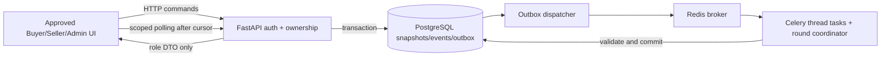

# NEGOTIATION ENGINE GAP ANALYSIS

19 أكتوبر 2026. **Production deployment version not verified.** المقارنة: N/frontend/lib/{competitive,demo-model,demo-integration}.ts مقابل O/backend/app/worker.py وmodels/routers المتاحة. فحص EC2 اللاحق إلزامي؛ لا نفترض أن ping هو كل الكود المنشور بالفعل.

## 1. ما ينفذه N فعلًا

- product/variant identity ثابتة؛ inventoryFor يولّد Seller listings صناعية، configuredListings يطبق إعداداتها المستقلة وmaterialized alternatives. ليست query لقائمة بائعين حقيقية.
- createCompetitiveSession ينسخ requirements/listing inputs، ويستبعد insufficient stock أو delivery mismatch أو disabled Agent.
- لكل listing thread مستقل وhistory؛ advanceCompetitiveRound يحسب الجولة من snapshot السابقة، ثم advanceCompetitiveStep يكشف رسالة واحدة لكل tick. هذا **interleaving للعرض** وليس عمليات agents موزعة.
- Buyer يبدأ target، ويتحرك ضمن maximum؛ Seller opening ثم concession مجدولة ومنافسة -25 SAR عند التفعيل، مع clamp إلى minimum بالهللات. strategy steady تتجاهل التخفيض التنافسي.
- best anonymous quote من الجولة السابقة؛ لا competitor name في إعلان الرسالة. provisional Agreement يحتاج رسالتي قبول بسعر واحد، stock/deadline مطابقين، وسعر ضمن الحدين.
- التوقف عند round cap أو غياب التحسن أو عدم وجود مشارك؛ ليست كل السيناريوهات ناجحة. rankedOffers يرتب السعر ثم delivery؛ الاختيار النهائي صريح.
- transition يحتفظ بـattempt ID وtimestamps/decision وAgreement واحدة وإشعارات/audit؛ التخزين browser v4. competitive approval لا يحجز أو يخفض مخزونًا؛ legacy one-to-one يخفض وحدة صناعية.
- timer في components/competitive-negotiation.tsx:56 يستدعي advance بعد 650ms في Buyer view. الخروج يوقف playback/يسجل pause؛ Seller/Admin لا يشغلان simulation أخرى.

هذه حدود محاكاة موثقة، وليست real Gemini أو Celery أو DB execution.

## 2. فجوات التنفيذ مقارنة بالمصدر Backend

| البند | N المحلي | O Backend | المطلوب لإنتاج مطابق | readiness / type |
|---|---|---|---|---|
| Buyer Agent | دالة deterministic داخل JS | غير موجود؛ worker ping | worker policy + private Buyer limits، server validation | BLOCKED / MISSING backend |
| Seller Agent | لكل listing snapshot/حدود مستقلة | seller_rules مخزنة فقط | owner-validated rules snapshot/execution | BLOCKED / MIXED |
| Gemini | لا network/model call | لا Gemini dependency/config/task في الملفات المتاحة | اختياري لاحقًا server-only؛ ليس شرط تحويل demo deterministic أولًا | NOT_VERIFIED حيًا / MISSING بالمصدر |
| Multi-Seller concurrency | loop/interleaved ticks | لا task negotiation أو parent/thread tables | مستقل لكل thread مع round barrier/snapshot عادل | BLOCKED / MISSING |
| Redis/Celery | لا استخدام بالواجهة | broker/result backend ومهمة ping | persisted jobs + retry/dedup/worker status | PARTIALLY_READY infrastructure فقط / MIXED |
| Buyer max/Seller floor | integer halala clamps/client raw synthetic state | DB max/min، لا engine enforcement | Decimal server-side predicates لكل offer/approval | BLOCKED / MISSING execution |
| Stock/delivery | session snapshot eligibility | stock DB، لا listing delivery | إدخال listing terms + initial/final checks + transaction stock policy | BLOCKED / MIXED |
| Rounds/strategy/concessions | max12 competitive، legacy20، steady/competitive | rule.max_rounds فقط | supported policy/version/round limits، أخطاء وأسباب واضحة | BLOCKED / MIXED |
| Anonymous competition | public eligible quote في history | لا engine/events | server permitted signal فقط، لا participant/global private payload | BLOCKED / MISSING |
| Final comparison | rankedOffers + explicit Buyer | لا final offers API | stored eligible final offers + expiry/terms version | BLOCKED / MISSING |
| Approval/rejection/cancel | local terminal guards/idempotent record | لا command APIs؛ status DB أربعة values | canonical state machine + authorization + idempotency | BLOCKED / MISSING |
| Agreement creation | local record/no reservation | Deal ORM، لا create command | transactional selected offer/quantity/total/stock/event | BLOCKED / MIXED |
| Failure/retries | scripted/exhaustion، browser warning | ping فقط | worker failure, retry budget, stuck detection, no duplicate decisions | BLOCKED / MISSING |
| Persistence/reconnect | localStorage، single active tab | DB tables جزئية | durable snapshots/events + cursor/resync across browsers | BLOCKED / MIXED |

## 3. قرارات منتج يجب حسمها قبل port

1. **mode:** docs/STAKEHOLDERS_JOURNEYS.md:23–25 يسمح automated closure ضمن تفويض سابق، بينما Requirements المنافسة في N لا يحتوي mode، والمنافسة تتطلب Buyer approval دائمًا. لا تدّع دعم competitive automated الحقيقي. v1 للمنافسة يحتفظ بالموافقة الصريحة؛ تضاف آلية تفويض موثقة للـautomated إذا أقرها الفريق، مع actor/time/limits version وإعادة checks، دون payment تلقائي.
2. **Pause:** pause في N يوقف العرض/advance. production execution لا يتوقف بإغلاق tab. افصل pause UI playback عن pause backend إن كان مطلبًا معتمدًا؛ لا تضف pause job بمجرد unmount.
3. **عدة listings لنفس Seller:** كود N:competitive.ts:116 يستبعد نفس listing ID من competing quotes لكنه لا يستبعد نفس ownerSellerId. لذلك قد يعامل قائمة أخرى للبائع نفسه كأنها منافس. eligible لا يفحص enabled/status مجددًا داخل هذا filter أيضًا. هذا سلوك مصدر يحتاج سياسة واختبارات، لا يُنقل تلقائيًا إلى engine الحقيقي. الإشارة المقترحة من **Seller مختلف** وعرض غير expired/declined ومستوفٍ للشروط؛ لا merge للقوائم.
4. **المخزون:** competitive demo لا يستهلك stock، بينما production الاتفاق الحقيقي يحتاج policy حجز/تخفيض atomic. إثبات availability عند بداية الجلسة ليس ضمانًا عند الموافقة.
5. **متعدد الخصائص:** warranty/condition/time-dependent curves في الوثائق أوسع من demo الحالي؛ N يطبق delivery/quantity eligibility وتفاوض سعر. لا scoring أو trade-off حقيقي للضمان/الشحن. لا تُخترع شروط ناقصة من DB.
6. auto-accept threshold موجود في legacy SellerRule، لكن competitive policy الحالية يقبل الطرفان counteroffer حين يقع ضمن الحدود مع final Buyer decision. حسم معنى threshold/strategy قبل parity port؛ لا تغيير التصميم لإخفاء تعارض semantics.

## 4. هندسة تنفيذ مقترحة — PROPOSED



- Start transaction يخزن parent/eligible thread snapshots والـoutbox ثم يرجع accepted. عدم بقاء tab مفتوح لا يؤثر على تقدم المهمة.
- task key مثل session/thread/round/action، optimistic version أو row lock؛ retry لا يولد عرضًا/رسالة ثانية. فحص cancel/terminal/status قبل كل commit.
- fairness: كل الجولة تستخدم نسخة عروض الجولة السابقة؛ اكتمال نتائج round ثم signals لللاحقة. لا advantage لترتيب loop أو worker الأسرع.
- قبول نفس السعر والشروط من الطرفين يسجل provisional offer، لا purchase. النهائي يتطلب authorized decision/recheck selected quote والكمية والتسليم والمخزون والإصدار وunique Agreement.
- crash بعد DB commit وقبل publication يعالجه outbox؛ publish بعد commit فقط، Redis replay ليس بديلًا عن DB log.
- deadlines/job timeout/retry limit والـstuck status أسباب حقيقية قابلة للعرض؛ لا عرض سيناريو failed مصطنع للمستخدم الحقيقي.

## 5. أبسط تحديثات حية موثوقة

**الاقتراح الأول polling** عبر GET snapshot/events، لسهولة اعتماده فوق FastAPI/Celery/Redis وNginx المتاحين دون streaming dependencies. مثال interval قابل للضبط 1–2 ثانية للجلسة النشطة ثم backoff للجلسة الخاملة؛ هذا اقتراح لا قياس أداء. execution بالخلفية مستقل عن polling أو tab visibility.

SSE لاحقًا مفيد لدفع اتجاه واحد إذا ثبتت الحاجة؛ HTTP commands تبقى للقرارات. WebSocket ليس شرطًا لهذا التدفق، ووجود Upgrade headers في Nginx لا يعني وجود WebSocket endpoint. يلزم اختبار buffering/timeouts/CDN فقط إذا اختير streaming.

### مثال event مقترح

```json
{
  "event_id":"event-example",
  "cursor":42,
  "session_id":"session-example",
  "thread_id":"thread-example",
  "type":"offer.created",
  "occurred_at":"2026-10-19T08:00:00Z",
  "session_version":8,
  "payload":{"agent":"Seller Agent","round":2,"unit_price":"4250.00","quantity":10,"delivery_days":5}
}
```

أنواع مقترحة: session.created/status_changed، thread.excluded/declined، offer.created، message.created، competition.announced، round.completed، buyer.approval_required، agreement.created، session.failed/cancelled/rejected، notification.created.

لا budget/floor ولا competitor identity في Seller event. server ينشئ payload role-specific، وليس global stream يخفيه frontend. command responses مرتبطة بـrequest/idempotency key وsession version.

reconnect: حفظ last applied cursor في ذاكرة العرض، طلب after، dedup event_id، reject stale versions؛ عند gap/retention expiry يعيد snapshot authoritative ثم cursor. 401 يوقف feed ويطلب sign-in؛ 403/404 ينظف تفاصيل غير مسموحة؛ network errors backoff/jitter مع offline banner؛ لا advance local ولا fake success أثناء الانقطاع. polling مستقل عن worker control.

## 6. اختبارات Backend المطلوبة

Parity fixtures للنماذج الثلاثة/الفشل، حد buyer/max/floor/discount، cent rounding، quantity/delivery/disabled/account suspension، نفس variant فقط، distinct Seller signals، repeat commands/tasks، worker crash/restart، cancelled أثناء round، stale approval، stock contention، unique Agreement، read projections، refresh/reconnect/event gap، no secret in prompts/logs/reports. كل ذلك على staging DB اصطناعية، لا records الإنتاج.

Gemini إن أضيف: لغة/اقتراح structured اختياري تحت validator deterministic؛ لا يستنتج السعر الحاسم أو يتجاوز floor/max. لا private limits/keys في frontend أو prompt غير مصرح به، ولا نص model يغيّر permissions/state. timeout/invalid output يعيد fallback policy معرّفة server-side ومعلنة، لا Mock fixture في production.


---

## تحديث الأدلة AWS-R1 — 19 أكتوبر 2026

**هذا ملحق جديد؛ النص السابق محفوظ كتاريخ للتدقيق، وتُقدَّم نتائج هذا الملحق عند تعارضها معه.** N هو العرض المحلي متعدد البائعين، وO المصدر المحلي القديم، وR المصدر المنسوخ من AWS في `<LOCAL_USER_HOME>\Documents\autoneg-production-reference`. تم فحص R محليًا للقراءة فقط. عبارة SOURCE_VERIFIED تعني وجود السلوك في المصدر، ولا تعني أنه يعمل في الحاوية المنشورة. بيانات الخادم التشغيلية أدناه من توثيق المستخدم؛ لم ننفذ اتصال AWS أو قاعدة بيانات.

الفرع المبلغ عنه `main`، والالتزام `0be5da348fd7c38da41f1628a4420135e02e2cd8`، مع تعديلات محلية على الخادم وعدم وجود Git revision label لصورة الواجهة. لذلك تطابق R مع صورة التشغيل، وDDL الفعلي، ونسخة migrations، وصلاحيات التشغيل، ونجاح التدفقات الحقيقية تظل **NOT_VERIFIED**. لا يجوز نسبة تعديلات working tree تلقائيًا إلى ذلك الالتزام.


### تصحيح نتيجة غياب محرك Backend

يوجد في R محرك حتمي **ثنائي** في `workspace.py:729–902`: يتناوب Buyer/Seller، يحفظ Offer/Audit، يلتزم بحدود snapshot ويقارن السعر المقبول. في semi_automated يظهر awaiting approval بعد قبول العرض؛ وفي automated يستدعي helper الإتمام داخل الطلب. هذا ليس تنفيذًا مستقلًا دائم التشغيل ولا Gemini؛ worker.py ما زال ping فقط.

| السلوك | R | N/المطلوب للإنتاج |
|---|---|---|
| عروض ثنائية محفوظة | موجودة في DB | المحافظة عليها وعلى تاريخها |
| شروط متعددة seller threads | غير موجودة | parent ومحركات threads مستقلة وcatalog matching |
| كمية وdeadline eligibility | يفحص stock>=1 أساسًا | quantity وحجز وتسليم لكل بائع |
| منافسة مجهولة | غير موجودة | مشاركة أفضل سعر مؤهل فقط مع حجب الهويات والتاريخ الخاص |
| التقدم | POST advance لكل خطوة | scheduler/worker أو orchestration موثوق؛ UI لا يكون مصدر الحقيقة |
| موافقة نهائية | موجودة ثنائيًا | موافقة اختيار عرض تنافسي مع تحقق وإجراء ذري |

### فجوات سلامة تحتاج Backend

- `_finalize_deal_in_db:683–726` يحاول تجنب Deal مكرر للجلسة ويخصم وحدة؛ ذلك لا يكفي لمنع سباق مخزون بين جلسات مختلفة أو لحجز 10 وحدات.
- approve يعيد فحص stock عبر helper، لكنه لا يعيد كل فحوص floor/rule-enabled كما يفعل advance؛ يجب إعادة التحقق وقت الموافقة من الشروط الفعلية المعتمدة.
- end يسمح بتعديل حالة جلسة مكتملة إلى cancelled مع بقاء Deal؛ يجب فرض terminal-state transitions دون العبث بالاتفاقيات القائمة.
- بعض privateLimits وقرارات العرض موجودة في audit/global state؛ لا تُرسل إلى الطرف غير المخوّل.
- سيناريو failure ومدخلات المحاكاة لا تُعد عقدًا إنتاجيًا معتمدًا. المدخلات تحتاج قيود أرقام منتهية/موجبة وmodes وrounds وقواعد ملكية.
- payment_status=completed ليس إثبات دفع. إنهاء تفاوض لا يجوز أن يؤدي إلى وصف دفع حقيقي دون خدمة موثوقة.

محرك N مرجع سلوك واختبار محلي، لا يستبدل DB ولا ينسخ أسرار كل Seller إلى المتصفح في إنتاج. يلزم ترجمة قواعده إلى خدمة خادم واختبارات مشتركة، مع إبقاء واجهة Buyer/Seller المعتمدة كما هي.


---

## AWS-R2 — تجهيز Frontend محليًا، 19 أكتوبر 2026

نُفذ تكامل المنتجات العامة مع تحقق الاستجابة والأخطاء، وأضيفت حدود typed/fail-closed للعقود الخاصة القائمة؛ لا bootstrap أو كتابة غير مخولة ولا fallback تجريبي في الإنتاج. تصاميم الأدوار وملكية Seller والمحاكاة محفوظة. نجحت 8 مجموعات اختبارات وTypeScript والبناء وstatic contract validation واختبار standalone على loopback. لا يثبت ذلك تشغيل FastAPI أو DB أو صورة AWS الفعلية؛ القرار NO-GO للنشر العام باقٍ.

النتائج وقائمة الملفات وقرارات الميزات: [FINAL_FRONTEND_INTEGRATION_REPORT.md](FINAL_FRONTEND_INTEGRATION_REPORT.md). الحزمة وأوامر staging والرجوع المعدة للموافقة فقط: [FRONTEND_STAGING_PLAN.md](FRONTEND_STAGING_PLAN.md). لم يُنفذ اتصال AWS أو نقل أو deploy أو تغيير قاعدة بيانات؛ تاريخ هذا التقرير السابق محفوظ.


## New evidence — 26 October 2026

This document preserves the earlier audit history. For the current authenticated production integration and model/storage matching, see docs/releases/PRODUCTION_RELEASE_REPORT_20261025.md and docs/releases/MODEL_MATCHING_RELEASE_20261025.md. Earlier NOT_VERIFIED/NO-GO statements must be interpreted with the later evidence; the copied AWS source was not proof of an identical running image. Production mock data is disabled. No staging fixtures are promoted.
